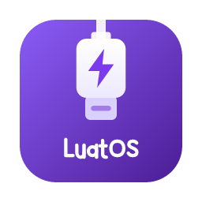
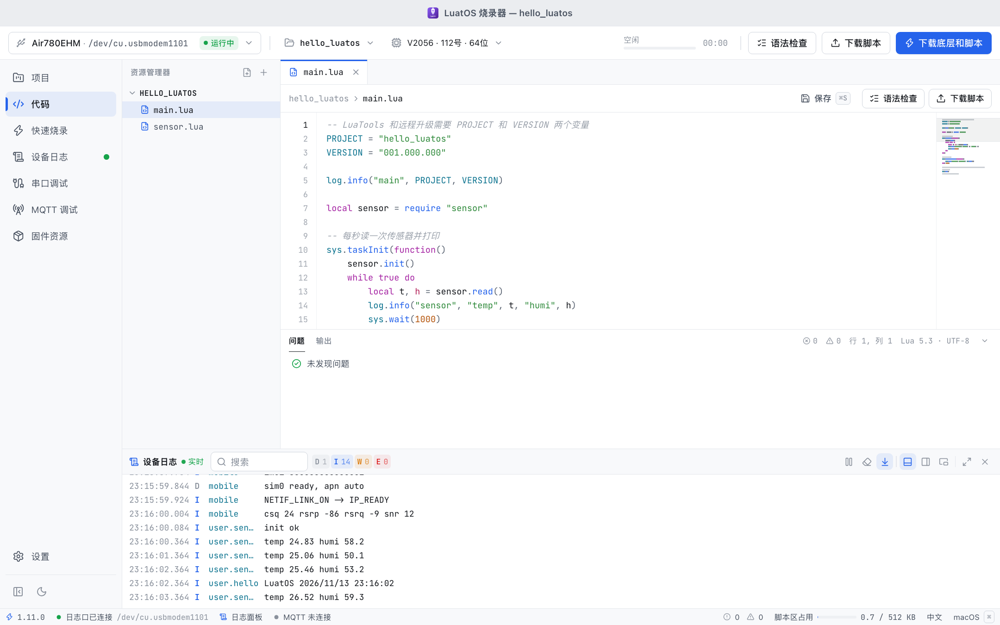
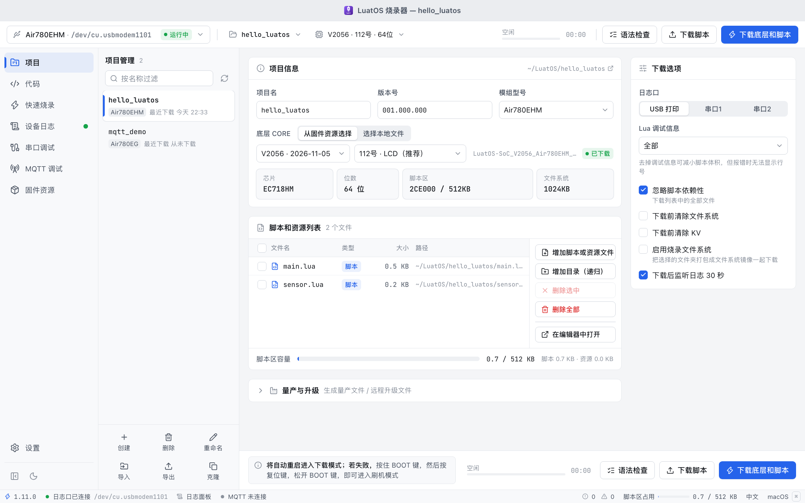
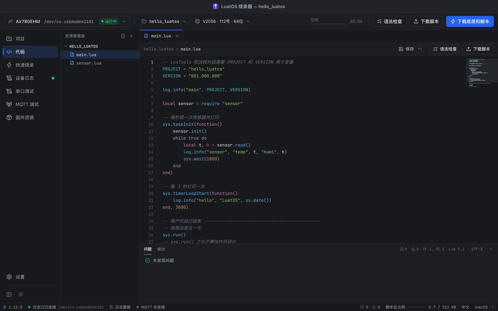
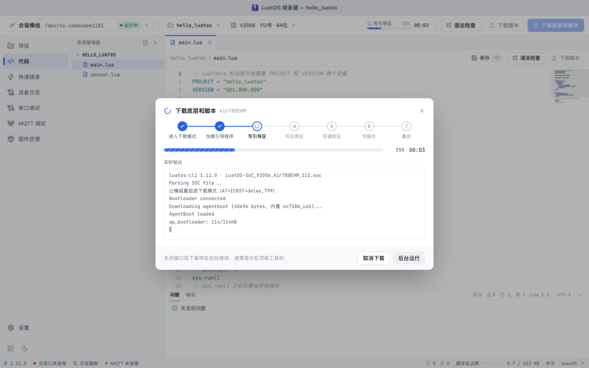
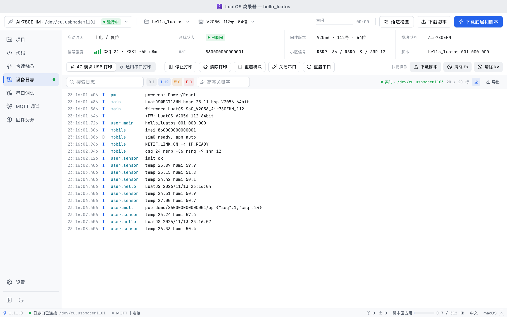
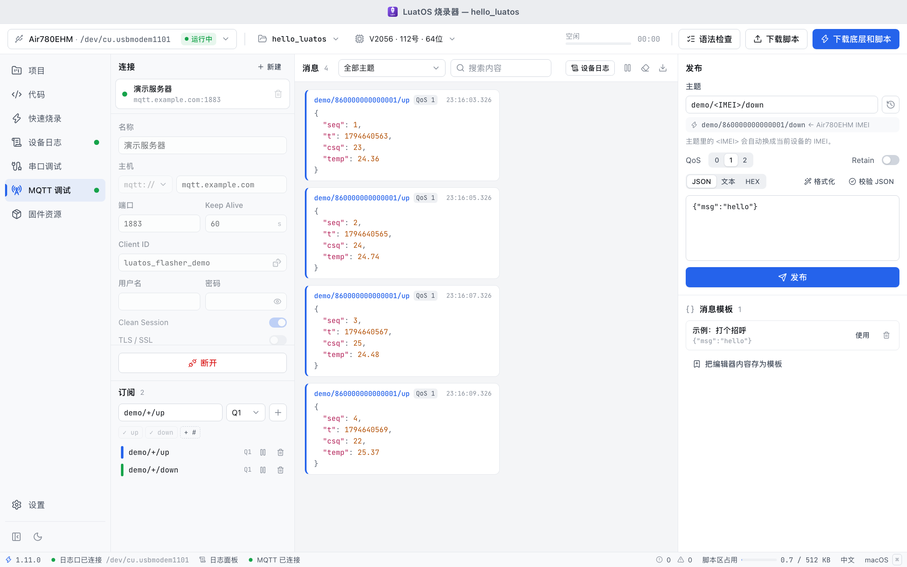
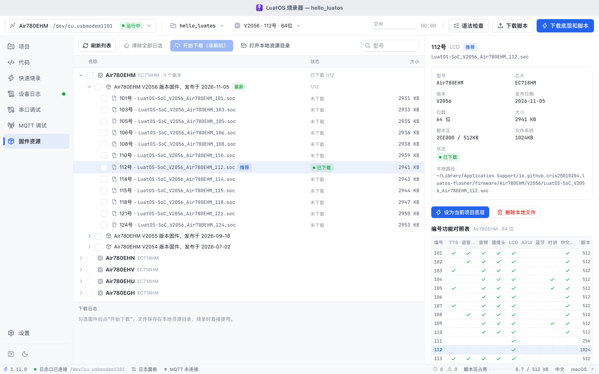

<p align="center">
  
</p>

<h1 align="center">LuatOS 烧录器</h1>

<p align="center">
  给 LuatOS 模组用的跨平台桌面工具：建项目、写 Lua、一键下载到模组、看设备日志、调串口和 MQTT。<br>
  面向 macOS 和 Windows，可以当作 LuaTools 的替代品。
</p>

> [!IMPORTANT]
> **测试情况**：目前只在 **macOS（Apple 芯片）** 上跑通了全流程——建项目、写代码、下载脚本和底层固件、看设备日志、MQTT 调试，实机验证过 Air780EHM 和 Air780EG。
> **Windows 版还没有测试过**：代码已经按 Windows 做了适配，但还没在 Windows 上编译和运行过，暂时没有 Windows 安装包。欢迎在 Windows 上试用并反馈。



> 文档里的截图都来自浏览器演示模式（假数据），不是真实设备。

---

## 目录

- [能做什么](#能做什么)
- [支持的模组](#支持的模组)
- [安装](#安装)
- [使用教程](#使用教程)
  - [1. 连接模组](#1-连接模组)
  - [2. 新建或导入项目](#2-新建或导入项目)
  - [3. 写代码](#3-写代码)
  - [4. 下载到模组](#4-下载到模组)
  - [5. 看设备日志](#5-看设备日志)
  - [6. MQTT 调试](#6-mqtt-调试)
  - [7. 串口调试](#7-串口调试)
  - [8. 固件资源](#8-固件资源)
  - [常见问题](#常见问题)
- [从源码编译](#从源码编译)
- [参与开发](#参与开发)
- [致谢](#致谢)
- [许可证](#许可证)

## 能做什么

| 页面 | 功能 |
|---|---|
| 项目 | 新建、重命名、克隆、删除；导入 LuaTools 的 `.ini` 项目、`.luatos` 项目包，或直接打开一个文件夹；选择底层固件（在线或本地 `.soc`）；查看脚本区容量；导出量产文件和升级文件 |
| 代码 | 多标签 Lua 编辑器，语法高亮、缩略图；用真正的 Lua 5.3 编译器做实时语法检查（和 LuatOS 同版本）；文件支持 GBK |
| 下载 | 「下载脚本」「下载底层和脚本」，分步骤显示进度；运行中的模组会被自动重启进下载模式，不用按 BOOT；底层固件没下载会先自动下载 |
| 快速烧录 | 不建项目，直接选固件和脚本文件夹烧录 |
| 设备日志 | 4G 模组 USB 日志（二进制解码）和普通串口文本日志；自动识别固件版本、型号、IMEI、联网状态、信号强度；重启模组、清除文件系统 / KV、导出日志 |
| 日志面板 | 在其它页面把设备日志停靠在下方、右侧，或作为悬浮窗，边调 MQTT / 串口边看模组输出 |
| 串口调试 | 文本或 HEX 收发、定时发送、历史记录、快捷指令 |
| MQTT 调试 | 多个连接、TLS + CA 证书、订阅管理、消息流（JSON 自动格式化）、发布（JSON / 文本 / HEX）、消息模板；主题里的 `<IMEI>` 自动换成当前设备 IMEI |
| 固件资源 | 按型号 → 版本浏览合宙官方固件，下载、缓存、删除；EC718H 系列的编号功能对照表 |
| 设置 | 中文 / English、浅色 / 深色主题、环境诊断（luatos-cli、串口、模组、USB 是否被虚拟机占用、固件服务器连通性） |

## 支持的模组

| 芯片 | 型号 | 现在能做的 |
|---|---|---|
| EC718 | Air780EHM / EHN / EHV / EHU / EGH / EGG / EGP / EPM / EP / EX2、Air700ECH / ECP、Air8000、Air1780H / P | 全部功能，USB 直连自动识别。实机验证过 Air780EHM（macOS） |
| EC618 | Air780E、Air780EG | 全部功能。实机验证过 Air780EG（macOS） |
| CCM4211 | Air1601 / 1602 / 1603 | 浏览和下载固件、建项目；刷机和设备日志还没做 |
| XT804 | Air6208 | 同上 |
| BK7258 | Air8101 | 同上 |
| UIS8910 | Air722、Air795UG | 同上 |

没有实机验证过的型号可能会遇到问题，欢迎提 Issue 或 PR。

## 安装

| 系统 | 状态 | 怎么装 |
|---|---|---|
| macOS（Apple 芯片，M1 及以后） | ✅ 全流程测试通过 | 到 [Releases](https://github.com/Cris20010204/luatos-flasher/releases) 下载 `LuatOS-Flasher_<版本>_macos_arm64.dmg` |
| macOS（Intel 芯片） | ⚠️ 没有测试过 | 暂无安装包，需要[自己编译](#从源码编译)（打通用包的方法见下文） |
| Windows 10 / 11 | ⚠️ 没有测试过 | 暂无安装包，需要在 Windows 上[自己编译](#从源码编译) |

**macOS**：打开 `.dmg`，把「LuatOS 烧录器」拖进「应用程序」。安装包没有苹果开发者签名，第一次打开会被系统拦下，到「系统设置 → 隐私与安全性」点「仍要打开」。如果提示“已损坏，无法打开”，在终端运行：

```bash
xattr -dr com.apple.quarantine "/Applications/LuatOS 烧录器.app"
```

**Windows**（未测试）：编译出的 `.msi` 或 `.exe` 安装包没有代码签名证书，SmartScreen 提示时点「更多信息 → 仍要运行」。模组可能要先装合宙的 USB 驱动。在 Windows 上遇到问题，欢迎提 Issue。

## 使用教程

### 1. 连接模组

用 USB 线把模组接到电脑。左上角的设备栏显示型号和端口，状态是「运行中」就说明识别到了。

- 模组正在下载模式（按着 BOOT 上电）时状态是「下载模式」，这时可以直接下载。
- 识别不到时，先到「设置 → 环境诊断」看看：Windows 上常见原因是没装驱动；用虚拟机的话，USB 设备可能被虚拟机占用了。

### 2. 新建或导入项目



在「项目」页左下角点「创建」：

1. 填项目名，选模组型号。
2. 选底层固件：从合宙的在线固件里选版本和固件（会自动下载并缓存），或者选一个本地 `.soc` 文件。
3. 选一个模板：空项目、Hello World，或 MQTT 示例。

已有项目可以这样带进来：

- **导入 LuaTools 项目**：选 LuaTools 生成的 `.ini` 文件。
- **打开文件夹**：直接把一个装着 `main.lua` 的文件夹当项目。文件留在原处，烧录器只记路径。
- **导入 `.luatos` 项目包**：其他人用本工具导出的项目包。

项目信息里能看到芯片、位数、脚本区地址和容量，下面的列表是会下载到模组的脚本和资源文件。

### 3. 写代码

在「代码」页编辑脚本，`⌘S` / `Ctrl+S` 保存。编辑器会一边写一边做语法检查，错误显示在行号旁和下方的「问题」面板里，点一下就能跳到对应行。

`Tab` 缩进 4 个空格，回车时自动缩进；`then`、`do`、`function` 之后会自动多缩进一级。



### 4. 下载到模组



工具栏上有两个按钮：

- **下载脚本**：只更新 Lua 脚本，几秒钟。平时改代码用这个。
- **下载底层和脚本**：同时刷底层固件。换固件版本或者模组第一次用时用这个。

模组在运行时，烧录器会让它自动重启进下载模式。如果卡在「进入下载模式」：

1. 按住模组的 BOOT 键；
2. 按一下复位键（或者重新上电）；
3. 松开 BOOT 键，模组会以「下载模式」重新出现，再点「重试」。

下载选项在项目页右侧，包括调试信息级别、是否只下载 `main.lua` 用到的脚本、下载前清除文件系统或 KV、下载后自动打开设备日志等。

### 5. 看设备日志



「设备日志」页实时显示模组的输出：

- **4G 模组 USB 打印**：EC718 / EC618 模组插上 USB 就能看，不用另接串口。
- **通用串口打印**：其它模组，或者通过 USB 转串口看 `uart` 输出。

顶部的设备信息由日志自动识别：启动原因、联网状态、信号强度、IMEI、固件版本、脚本名和版本。可以按级别筛选、搜索、高亮关键字、暂停、导出，还能直接重启模组、清除文件系统和 KV。

在其它页面也能看日志：点工具栏的「设备日志」按钮，或者底部状态栏的「日志面板」，选择停靠在下方、右侧，或者悬浮在页面上。上面第一张截图就是代码页下方停靠着日志面板。

### 6. MQTT 调试



1. 在左侧「连接」里填你的 MQTT 服务器地址、端口、用户名和密码，需要的话打开 TLS 并选 CA 证书，然后点「连接」。只想试一试的话可以用 EMQX 的公共测试服务器 `broker.emqx.io`（所有人共用，不要发敏感数据）。
2. 在「订阅」里添加主题，支持 `+` 和 `#` 通配符。每个订阅一种颜色，可以单独暂停。
3. 在右侧「发布」里写主题和内容。主题里写 `<IMEI>` 会自动换成当前模组的 IMEI，例如 `demo/<IMEI>/down`。内容可以是 JSON、文本或 HEX，常用的内容可以存成「消息模板」。

新建项目时选「MQTT 示例」模板，模组会每 5 秒往 `demo/<IMEI>/up` 发一条消息，并订阅 `demo/<IMEI>/down`。把模板里的服务器地址改成你自己的，就能和这个页面对着调。

### 7. 串口调试

「串口调试」页可以选端口、波特率、数据位、校验位、停止位，按文本或 HEX 收发，支持定时发送、发送历史和快捷指令（默认有 `AT`、`AT+CSQ`、`AT+CGSN`、`ATI`）。在接收区点右键，可以复制、另存或清空。

### 8. 固件资源



按型号和版本浏览合宙的官方固件，可以批量下载、删除本地缓存，也可以把某个固件设为当前项目的底层。EC718H 系列（Air780EHM 等）右下角有编号功能对照表，能看出每个编号的固件带哪些功能（TTS、LCD、蓝牙等）和脚本区大小。

### 常见问题

**下载时一直卡在「进入下载模式」**
按上面[下载到模组](#4-下载到模组)里的方法手动进入下载模式。还不行的话，检查 USB 线是不是只能充电、不能传数据的那种。

**设备日志打开了但是没有内容**
确认模组在「运行中」，日志模式选「4G 模组 USB 打印」。模组的 USB 日志口输出的是二进制，用「通用串口打印」打开只会是空白或乱码。

**Windows 上识别不到模组**（Windows 版还没测试过）
安装合宙的 USB 驱动，到合宙资料中心 [docs.openluat.com](https://docs.openluat.com/) 搜索“USB 驱动”。

**MQTT 连接的密码存在哪里**
保存在本机应用存储里，是明文。不要在共用电脑上保存生产环境的密码。

## 从源码编译

### 准备

- [Node.js](https://nodejs.org/) 20 以上，以及 pnpm 10（`corepack enable`）
- [Rust](https://rustup.rs/) 1.90 以上
- macOS：Xcode 命令行工具（`xcode-select --install`）
- Windows：Visual Studio C++ 生成工具、WebView2（Windows 10/11 一般自带）

### 编译运行

```bash
git clone https://github.com/Cris20010204/luatos-flasher.git
cd luatos-flasher
pnpm install
pnpm build:cli      # 从源码编译打过补丁的 luatos-cli（约 1 分钟），放到 src-tauri/binaries/
pnpm tauri dev      # 启动桌面应用（改代码自动刷新）
pnpm tauri build    # 打安装包：macOS 出 .app 和 .dmg，Windows 出 .msi 和 .exe
```

`pnpm build:cli` 也可以换成 `pnpm fetch:cli`，直接下载官方发布的 luatos-cli，但官方版有下面说的几个问题。

### 只改界面：浏览器演示模式

```bash
pnpm dev
```

然后用浏览器打开 <http://localhost:1420/?demo>。这时所有后端调用都换成 `src/lib/demo.ts` 里的假数据：一台假的 Air780EHM、两个示例项目、滚动的设备日志、能收发的 MQTT、会回 AT 的串口、能走完全程的下载进度。改界面不需要接模组，也不需要编译 Rust。

网址参数可以直接打开指定页面，比如 `?demo&page=code&project=demo-hello&file=main.lua&dock=bottom`，参数说明在 `src/lib/demo.ts` 开头。README 里的截图就是用 `node scripts/screenshots.mjs` 按这些参数自动生成的（需要本机装有 Chrome，并先运行 `pnpm dev`）。

### 检查

```bash
pnpm typecheck                     # TypeScript 类型检查
node scripts/smoke-render.mjs      # 把所有页面渲染一遍，抓运行时错误
cd src-tauri && cargo test         # 后端单元测试
MQTT_TEST_HOST=broker.emqx.io cargo test -- --include-ignored   # 另含联网测试（合宙固件服务器、MQTT 收发）
```

### 关于 luatos-cli 补丁

刷机、日志解码、量产和 FOTA 都交给 [luatos-cli](https://github.com/wendal/luatos-cli) 完成，烧录器把它作为附带程序打包进去。`pnpm build:cli` 会拉取固定版本（v1.11.0）的源码，打上 `scripts/patches/` 里的补丁再编译：

1. **EC718 日志解码**：固件把 `0x7D` 转义成 `7D 01`、`0x7E` 转义成 `7D 02`，官方版按标准 HDLC 还原，结果 `}` 显示成 `!`、`~` 显示成 `"`。
2. **制表符分隔**：老版本 EC618 固件的日志里，模块名和正文之间用的是制表符，官方版只认空格。
3. **EC618 刷机**（Air780E / EG）：使用固件包自带的 AgentBoot（下载引导程序），CP 程序写入独立的 CP flash。官方版用的是 EC718 的 AgentBoot，CP 也写错了 flash。

luatos-cli 仓库把 AgentBoot 等二进制文件放在 Git LFS 里，没装 git-lfs 时克隆下来的只是占位文本。编译脚本会自动从 GitHub 下载真文件并按 SHA-256 核对，不需要安装 git-lfs。这些补丁欢迎合入上游；上游修复后可以删掉对应补丁。

### 其它打包说明

- **macOS 通用包**（Apple 芯片 + Intel）：`rustup target add x86_64-apple-darwin`，分别运行 `pnpm build:cli aarch64-apple-darwin` 和 `pnpm build:cli x86_64-apple-darwin`，用 `lipo -create` 合成 `src-tauri/binaries/luatos-cli-universal-apple-darwin`，再运行 `pnpm tauri build --target universal-apple-darwin`。
- **在命令行或远程环境打 DMG**：加 `CI=true`（`CI=true pnpm tauri build`），跳过让访达排版 DMG 窗口的步骤。
- **网络走代理时**：cargo 连不上 crates.io 可以检查 git / cargo 的代理设置；Node 报 `UNABLE_TO_GET_ISSUER_CERT_LOCALLY` 时，可以把系统根证书导出后用 `NODE_EXTRA_CA_CERTS` 指给 Node。
- **改图标**：图标源文件是 `app-icon.svg`（`design/icon-gen/` 里的脚本生成），改完运行 `pnpm tauri icon app-icon.svg`。

## 参与开发

### 目录结构

```
src/                      前端（React 19 + Tailwind CSS 4）
  lib/api.ts              所有后端接口和事件，类型和 src-tauri 里的结构体一一对应
  lib/demo.ts             浏览器演示模式的假数据
  store.tsx               全局状态：设备、项目、编辑器、下载任务、固件缓存
  devlog.tsx              设备日志：解析、识别设备信息、日志面板状态
  data/catalog.ts         型号、芯片家族、固件编号功能对照表
  data/types.ts           数据类型、新建项目模板、默认值
  components/             界面组件（编辑器、日志面板、对话框等）
  pages/                  各个页面
src-tauri/src/            后端（Rust + Tauri 2）
  devices.rs              串口扫描、识别合宙模组
  cli.rs                  调用 luatos-cli：刷机、设备日志、重启、量产、FOTA
  firmware.rs             合宙固件列表、下载、缓存，.soc 解析
  projects.rs             项目和文件、LuaTools .ini 导入、.luatos 包、Lua 语法检查
  serial.rs / mqtt.rs     串口调试 / MQTT 调试
  doctor.rs               环境诊断
scripts/                  luatos-cli 编译和下载、补丁、冒烟测试、截图
design/icon-gen/          图标生成脚本
docs/images/              README 截图
```

### 约定

- 新增后端命令：在 `src-tauri/src/*.rs` 写 `#[tauri::command]`，在 `lib.rs` 的 `generate_handler!` 里登记，再在 `src/lib/api.ts` 加类型和包装函数。前端不要直接调用 `invoke`。新命令最好也在 `src/lib/demo.ts` 里补一份假数据。
- 界面文案同时写中文和英文：`t('中文', 'English')`。
- 提交前至少跑一遍 `pnpm typecheck`、`node scripts/smoke-render.mjs` 和 `cargo test`。
- 设计决定和踩过的坑记在 [CLAUDE.md](CLAUDE.md)，改相关代码前建议先读一下。

欢迎提交 Issue 和 PR，尤其是：其它型号的实机测试结果、Windows / Linux 上的使用反馈、CCM4211 / XT804 / BK7258 / UIS8910 的串口刷机。

## 致谢

这个项目站在很多人的肩膀上，特别感谢：

- **[luatos-cli](https://github.com/wendal/luatos-cli)**（作者 [wendal](https://github.com/wendal)，MIT 许可）：刷机、日志解码、量产、FOTA 全靠它，是烧录器的核心引擎。没有它，就不会有这个项目。我们在它的基础上做了几个补丁（见上文），也欢迎合入上游。
- **[LuatOS](https://github.com/openLuat/LuatOS)**（合宙 [openLuat](https://github.com/openLuat)，MIT 许可）：运行在模组上的系统。示例代码、模组资料、在线固件都来自合宙的开源工作和资料中心 [docs.openluat.com](https://docs.openluat.com/)。
- **合宙 LuaTools**：官方烧录工具。本项目的功能和操作习惯参考了它。
- **[yuzhan-tech/ectool](https://github.com/yuzhan-tech/ectool)** 和 **[luatos-tools](https://github.com/yuzhan-tech/luatos-tools)**：移芯 EigenComm 芯片下载流程的开源实现，EC618 刷机补丁参考了它们的分区写法和 AgentBoot 选择。
- 开源框架和库：[Tauri](https://tauri.app/)、[React](https://react.dev/)、[Tailwind CSS](https://tailwindcss.com/)、[Lucide](https://lucide.dev/) 图标、[mlua](https://github.com/mlua-rs/mlua)、[rumqttc](https://github.com/bytebeamio/rumqtt)、[serialport-rs](https://github.com/serialport/serialport-rs)、[reqwest](https://github.com/seanmonstar/reqwest)、[sevenz-rust2](https://crates.io/crates/sevenz-rust2)、[JetBrains Mono](https://www.jetbrains.com/lp/mono/) 字体等。

本项目是社区作品，不是合宙官方产品。LuatOS、LuaTools、Air780 等名称属于上海合宙通信科技有限公司，在这里只用来说明本工具适用于哪些产品。应用图标是原创设计，没有使用合宙的标志。

## 许可证

[MIT](LICENSE)
